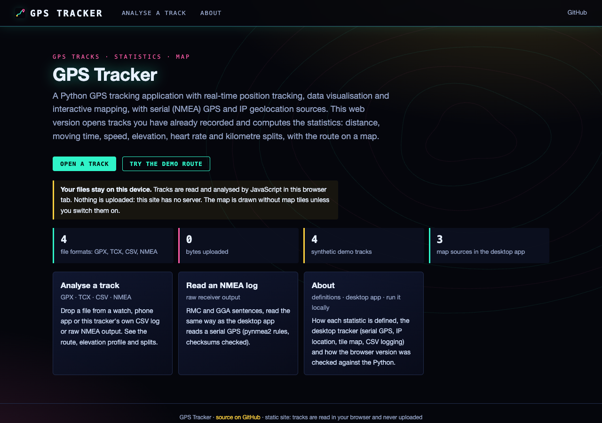
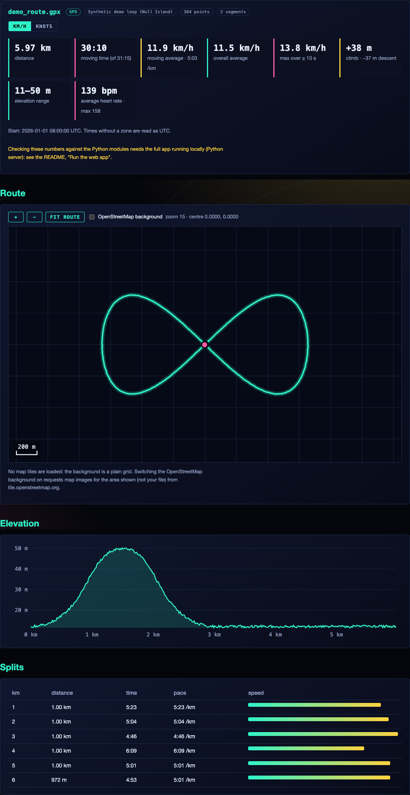

# GPS Tracker with Real-Time Mapping

A Python-based GPS tracking application that provides real-time position tracking, data visualization, and interactive mapping capabilities. The application supports multiple location data sources and features a robust offline-capable mapping system.

## Features

- **Multiple Location Sources**
  - Serial GPS device support (NMEA protocol)
  - IP-based geolocation
  - Automatic GPS device detection
  - Easy switching between data sources

- **Interactive Mapping**
  - Real-time position tracking
  - Multiple map providers (OpenStreetMap, OpenTopoMap, CyclOSM)
  - Local tile caching for offline use
  - Scale bar and zoom controls
  - Track visualization
  - Draggable map interface

- **Data Collection**
  - Real-time GPS data display
  - CSV data logging
  - Track history recording
  - Basic statistics (speed, altitude, etc.)

- **User Interface**
  - Clean, modern PyQt6-based interface
  - Tabbed organization
  - Status indicators
  - Configuration options

## Requirements

### Hardware
- Optional: Serial GPS device (NMEA compatible)
- Computer running Windows, macOS, or Linux

### Software
- Python 3.11 or later
- Required Python packages (see Installation)

## Installation

1. Clone the repository:
```bash
git clone https://github.com/yourusername/gps-tracker.git
cd gps-tracker
```

2. Create and activate a virtual environment (recommended):
```bash
python -m venv venv
source venv/bin/activate  # On Windows: venv\Scripts\activate
```

3. Install required packages:
```bash
pip install -r requirements.txt
```

## Usage

1. Start the application:
```bash
python main.py
```
(`gps-tracker.py` is the original single-file version, kept for reference.)

2. Select a location source from the dropdown menu:
   - If using a GPS device, it should be automatically detected
   - IP Geolocation is always available as a fallback

3. Main interface features:
   - **Show Map**: Opens the interactive map window
   - **Start Logging**: Begin recording GPS data to a CSV file
   - **Clear Track**: Erases the current track history
   - **Refresh Devices**: Scan for new GPS devices

4. Map controls:
   - Click and drag to pan
   - Mouse wheel or +/- buttons to zoom
   - Drop-down to select different map styles
   - Scale bar shows current map scale

## Technical Details

### Architecture

The application is built with a modular design consisting of several key components:

#### Location Providers
- Abstract base class `LocationProvider` defines the interface
- `SerialGPSProvider`: Handles GPS device communication
- `IPLocationProvider`: Provides IP-based location
- `LocationProviderManager`: Manages provider lifecycle

#### Mapping System
- `TileManager`: Handles map tile downloading and caching
- `MapWidget`: Renders map and handles user interaction
- `ScaleBar`: Provides dynamic scale information

#### Data Management
- SQLite database for map tile caching
- CSV logging for track data
- Real-time data processing

### File Structure

```
gps-tracker/
├── main.py            # Entry point (PyQt6 app)
├── gui.py             # Main window: live data, logging, track distance
├── providers.py       # Serial NMEA GPS and IP geolocation sources
├── mapping.py         # Tile cache, scale bar, map widget
├── geo.py             # Qt-free projection, scale and distance maths
├── tile_servers.py    # Map tile server list
├── track_io.py        # Read GPX / TCX / CSV tracks (track_nmea.py: NMEA logs)
├── track_stats.py     # Distance, moving time, speed, elevation, splits
├── web/               # Web interface + static site (see below)
├── tests/             # pytest suite (+ fixtures, JS-vs-Python checks)
├── map_cache/         # Cached map tiles (created on first use, not in git)
│   └── tile_cache.db
├── requirements.txt   # Python dependencies
└── README.md
```

See `INTERFACE.md` for the full module map.

### Key Classes

#### GPSWindow
Main application window handling:
- User interface
- Data updates
- Provider management
- Logging control

#### TileManager
Map tile management including:
- Multiple server support
- Rate limiting
- Caching system
- Error handling

#### MapWidget
Interactive map display with:
- Tile rendering
- Track visualization
- User input handling
- Dynamic updates

## Web interface

**Live site: https://gddickinson.github.io/gps-tracker/** (static, nothing to install)

Open a recorded track (GPX, TCX, CSV such as this app's own log, or a raw NMEA log) in the browser and get the
distance, moving time, average/moving/max speed (km/h or knots), climb and descent, heart rate and per-km (or mile)
splits, with the route on a map and an elevation profile. **Files never leave your device**: they are read by
JavaScript ports of `track_io.py`, `track_nmea.py`, `track_stats.py` and `geo.py`, tested against the Python
(`node web/static/track_engine.test.mjs`, `tests/test_js_port.py`). The map is drawn without tiles; an optional
OpenStreetMap background (with attribution) loads tiles for the area shown only when switched on. The demo tracks are
synthetic (an invented loop at 0° N, 0° E), written by `scripts/make_demo_tracks.py`.




### Run the web app

```bash
pip install -r requirements-web.txt
python run_web.py          # http://127.0.0.1:8161
```

The local app adds "Check with the Python modules", which runs the Python code on your file and compares every value.
Tests: `python -m pytest -q tests test_providers.py`. Build the static site: `python scripts/build_static.py`
(published by `.github/workflows/pages.yml` on push to main; one-time setup: Settings → Pages → Source "GitHub Actions").

## Contributing

Contributions are welcome! Please feel free to submit a Pull Request.

### Development Setup

1. Fork the repository
2. Create a feature branch
3. Follow the installation instructions above
4. Make your changes
5. Submit a pull request

### Guidelines

- Follow PEP 8 style guide
- Add comments for complex functionality
- Update documentation as needed
- Add tests for new features

## License

This project is licensed under the MIT License - see the LICENSE file for details.

## Acknowledgments

- OpenStreetMap and contributors for map data
- PyQt6 team for the GUI framework
- Various map tile providers

## Troubleshooting

### Common Issues

1. **No GPS devices detected**
   - Check USB connections
   - Verify device permissions
   - Try refreshing devices

2. **Map tiles not loading**
   - Check internet connection
   - Verify firewall settings
   - Try different map providers

3. **Serial port errors**
   - Check device permissions
   - Verify correct port selection
   - Ensure proper baud rate

### Debug logging

`main.py` logs at INFO level. For more detail, change `level=logging.INFO` to `logging.DEBUG` in `main.py`
(there is no `--debug` command-line flag).

## Future Enhancements

Planned features for future releases:
- Multiple simultaneous tracks
- Elevation profiles
- Route planning
- Weather data integration
- Additional map sources
- Mobile device support
- Network GPS receiver support
- Advanced statistics and analysis

## Support

For support, please:
1. Check the troubleshooting guide
2. Search existing issues
3. Create a new issue with:
   - Detailed problem description
   - Error messages
   - System information

---
*Built with AI assistance from [Claude (Anthropic)](https://claude.com/).*
